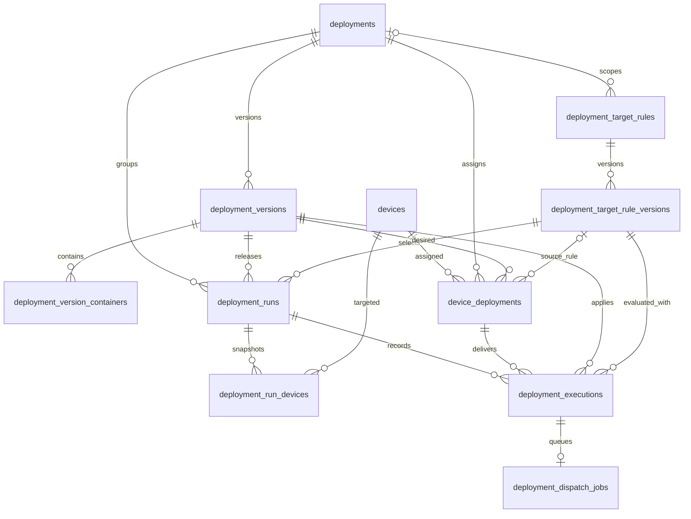

# Deployment database architecture

This document describes the deployment-related schema currently present in the
local Sealman PostgreSQL database. It was generated from the running Docker
database (`postgres`, schema `public`) on 2026-11-11 at Alembic revision
`d1e2f3a4b5c6`. The follow-on `e2f3a4b5c6d7` migration adds the durable
IoT Edge dispatch outbox described below.

## Overview

The schema separates deployment definitions and their version records from
target-rule versions, rollout runs, desired device assignments, and per-device
delivery history.

`devices.device_id` is the device key used by both device-related tables. It is
`TEXT`, matching the existing device schema. `o|` in the diagram indicates an
optional relationship: a target rule may have no deployment association, and
an assignment may have no source rule version.

## Table roles and usage

### `deployments`

Stores the identity and high-level metadata for a deployment definition:
unique name, deployment type, optional description, creation time, and an
optional soft-delete timestamp.

**Why it exists:** The definition is the stable object users identify and
manage, while its deployable contents can evolve through separate version
records. Keeping identity separate avoids overwriting the definition each time
its content changes.

**How it is used:** Create one row when a deployment is defined. Reference it
from each version, rollout run, and per-device assignment. Use `deleted_at`
when it should no longer be offered while preserving historical references.

### `deployment_versions`

Stores a numbered snapshot of a deployment's content, including its
`content_hash`, serialized `definition`, change note, and creation time.
`(deployment_id, version)` is unique.

**Why it exists:** Rollouts and device assignments need a stable, identifiable
revision rather than a pointer to mutable current content. The hash can
identify equivalent content, and the change note records why a revision was
created.

**How it is used:** Add a row for each deployment revision and select that row
when creating a run or assigning a desired state to a device. Existing run,
assignment, and execution references use restrictive foreign keys to protect
versions that are already in use.

### `deployment_version_containers`

Stores a service/container entry for a deployment version, including its
service name, image, and JSONB `config_spec`. The primary key is
`(deployment_version_id, service_name)`.

**Why it exists:** A single deployment version can describe multiple
containers/services, each with its own image and configuration. Storing these
as child rows supports querying and constraining individual services without
packing all of them into one opaque field.

**How it is used:** Add one row per service in a version. The foreign key
cascades when its parent version is removed, so these dependent details do not
become orphaned. The local database currently has no rows in this table.

### `deployment_target_rules`

Stores the identity and lifecycle state of a target rule: name, optional
association to a deployment, and optional soft-delete timestamp.

**Why it exists:** A rule defines which devices are eligible for a rollout and
has a lifecycle independent of any particular rollout. The nullable deployment
association allows rules without a deployment owner while retaining the
ability to associate one where required. Soft deletion removes a rule from
future use without erasing its history.

**How it is used:** Create a rule, then create versioned expressions in
`deployment_target_rule_versions`. A run records the exact rule version it
used, so later rule edits do not change the meaning of an earlier run. Rules
have no separate enabled/disabled state.

### `deployment_target_rule_versions`

Stores versioned JSONB rule expressions, with version number, creation time,
and optional creator. `(rule_id, version)` is unique, and the version must be
positive.

**Why it exists:** Target criteria can change, and historical rollouts must
remain explainable against the criteria used at the time. A version row
preserves that snapshot instead of making runs depend on the rule's latest
expression.

**How it is used:** Create a new row when a rule's expression is revised.
Reference the chosen row from a run and optionally from a device assignment or
execution to retain the exact selection criteria. Immutability is an
application-level convention, not a database-enforced prohibition on updates.

### `deployment_runs`

Represents one rollout attempt, linking a deployment, a deployment version,
and a target-rule version. It has a UUID identifier, trigger metadata, a
nullable unique `idempotency_key`, and total/succeeded/failed/pending device
counters; all counters must be nonnegative.

**Why it exists:** A version is a reusable release, but each attempt to
distribute it is a separate operational event. The run groups the target
snapshot and aggregate progress for that attempt.

**How it is used:** Create a run when a rollout is confirmed, populate its
target devices in `deployment_run_devices`, and create the initial per-device
execution records. Repeated create requests with the same idempotency key and
selected versions return the existing run instead of creating another
assignment generation. Referencing versioned content and criteria makes the
attempt traceable.

### `deployment_run_devices`

Stores each device included in a run and its state at the run level. Its
composite primary key is `(run_id, device_id)`; `device_id` references the
existing `devices.device_id` text key.

**Why it exists:** A run needs a durable record of which devices were selected
and their progress, even if the target rule later changes or device metadata
is updated.

**How it is used:** Insert one row per selected device when a run is assembled,
then update `state` as that device progresses. Rows are deleted with their
parent run; the device foreign key restricts deleting a device while a run
snapshot references it.

### `device_deployments`

Stores the current desired assignment for a device and deployment: desired
version and state, assignment source, optional rule-version provenance, and
assignment generation. `(device_id, deployment_id)` is unique, so there is at
most one current assignment per device/deployment pair.

**Why it exists:** The run is a record of a rollout attempt; this table instead
represents the desired configuration currently assigned to each device. The
generation allows newer assignments to be distinguished from older ones.

**How it is used:** Create or update the row when assigning or changing the
desired deployment for a device. Increment the generation as required by the
assignment workflow and use it to correlate resulting delivery reports.

### `deployment_executions`

Stores per-device delivery/execution history. Each UUID row references a run,
a device assignment, deployment version, and rule version, and records
generation, content hash, state, trigger source, and timestamp. Generation
must be positive.

**Why it exists:** A current assignment alone cannot explain the sequence of
delivery attempts or their outcomes. This table preserves an event-level
history for tracking and troubleshooting.

**How it is used:** Record an execution when a rollout is confirmed and
associate it with the relevant run and assignment. The current workflow only
creates `QUEUED` records with an outbox job in the same transaction. Delivery
updates the execution through dispatch, submission, and Edge Agent-reported
application states. Restrictive foreign keys preserve the referenced run,
assignment, and versioned context.

### `deployment_dispatch_jobs`

Stores one durable dispatch job per execution, including the expected device
assignment generation, retry count, next eligible time, lease metadata, and
the IoT Hub desired-twin version awaiting Edge Agent confirmation.

**Why it exists:** The rollout transaction must not lose dispatch work when the
API process restarts. A persisted `not_before` timestamp allows workers to
release a job after throttling instead of occupying a worker while waiting.

**How it is used:** Workers claim jobs in a short database transaction, lock
the job and current assignment row, and compare the job's expected generation
with the current assignment generation before dispatch. A partial unique index
allows at most one `LEASED` job per device, serializing concurrent workers
without holding database locks during HTTP requests. The worker sends the
saved definition as IoT Hub `applyConfigurationContent` for `$edgeAgent` and
`$edgeHub`, then reads the desired-twin version. `SUBMITTED` means IoT Hub
accepted the update; it is not counted as applied until the Edge Agent reports
the matching desired-twin version with a successful desired-state status and
the expected runtime status for each desired system and user module.

Most deployment entities use integer IDs; run and execution IDs are UUIDs.
JSONB is used for container configuration and rule expressions. Version and
history references use `ON DELETE RESTRICT` so referenced records cannot be
removed; container details cascade with their version, and run-device snapshots
cascade with their run.

## Deployment image catalog

The IoT Edge module editor can browse repositories and tags in the configured
Azure Container Registry. The API reads `DEPLOYMENT_REGISTRY_HOST`,
`DEPLOYMENT_REGISTRY_USERNAME`, and `DEPLOYMENT_REGISTRY_PASSWORD` from its
environment and proxies read-only catalog requests through the Azure
Container Registry data-plane API. Credentials and registry tokens remain on
the API and are never returned to the browser. When a deployment references
that registry, the API injects the configured credentials into
`$edgeAgent.runtime.settings.registryCredentials` in the desired twin so the
device can pull private images. This sends the registry credentials to IoT Hub
and the target device; use a least-privilege registry account. The browser
continues to allow manually entered images, including Microsoft Container
Registry images.

The API requires catalog/metadata-read permission on the registry. Local
development deployments that load the platform `.env` should provide these
variables there; do not commit registry credentials.

## Data currently present

The following row counts were read from the live database when this document
was generated:

| Table | Rows |
|---|---:|
| `deployments` | 5 |
| `deployment_versions` | 4 |
| `deployment_version_containers` | 0 |
| `deployment_target_rules` | 3 |
| `deployment_target_rule_versions` | 3 |
| `deployment_runs` | 0 |
| `deployment_run_devices` | 0 |
| `device_deployments` | 0 |
| `deployment_executions` | 0 |

There are definitions and rule versions in the database, but no persisted
container rows, rollout runs, device assignments, or delivery history yet.
The row counts above predate the dispatch-outbox migration and do not include
`deployment_dispatch_jobs`.

## Integrity and lifecycle notes

- Foreign keys protect references to deployments, versions, rules, runs, and
  existing devices.
- Deployment names and version numbers are protected by unique constraints.
- Deployment and target-rule rows have `deleted_at` fields for soft deletion.
- Target-rule versions and deployment versions are represented as separate
  rows. The schema provides versioned records, but immutability is an
  application-level convention rather than a database update prohibition.
- Foreign keys validate that referenced rows exist. They do not enforce that
  all related rows use matching deployment IDs (for example, that a run's
  deployment ID is the same deployment that owns its selected version); writes
  must maintain that consistency.
